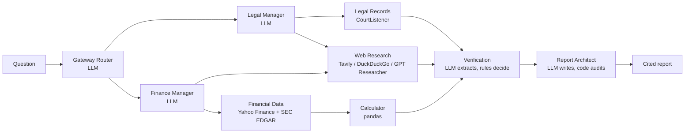

# DeepSearch

A multi-agent research system for **legal and financial questions**. Ask something like
*"How did the SEC's 2018 case against Elon Musk affect Tesla's stock?"* and a team of agents
plans the work, gathers sources, checks every claim and writes a cited report you can watch being built.

It runs with **zero API keys and zero cost**: free public data (CourtListener court records, SEC EDGAR
filings, Yahoo Finance prices, DuckDuckGo) and a rule-based stand-in when no Gemini key is set.
An academic project; not legal or investment advice.

The full design, every decision (D1–D52) and the build history are in
[`docs/KNOWLEDGE.md`](docs/KNOWLEDGE.md). Demo and viva notes are in [`docs/VIVA.md`](docs/VIVA.md).

---

## Quick start (Windows)

You need **Python 3.12** ([python.org](https://www.python.org/downloads/)) and **Node.js 18+**
([nodejs.org](https://nodejs.org/)). Then, in the project folder:

```bat
setup.cmd
start.cmd
```

`setup.cmd` installs everything once (a few minutes). `start.cmd` opens the backend and frontend in two
windows and the app at **http://localhost:5173**. Close the two windows to stop it. `test.cmd` runs every
automated test.

No keys are needed. Try a **recorded demo** from the Dashboard first (real, dated sources), then a live
question such as *"How has Nvidia stock performed over the last year?"*

## What it does



- **Planning is separate from doing.** LLM agents plan, extract claims and write; searching, fetching and all
  arithmetic are ordinary code. A run makes **at most 8 LLM calls** (enforced).
- **Every figure comes from code.** The model writes placeholders such as `{{calc:ret_period}}`; code fills
  them from pandas calculations and audits the report for any number it did not compute.
- **Verification is rules, not opinions.** Each claim is *verified* (official or court source, or computed),
  *corroborated* (two independent sources), *unverified* or *conflicting*. Allegations are never written as facts.
- **Honest labels everywhere:** live runs, recorded demos and the offline sample replay are always marked.

**Screens:** Landing, Login and Sign Up (demo screens), Dashboard, New Research, Research Execution (live agent
graph and activity feed), Research Workspace (findings, sources, chart, timeline), Final Report (citations,
integrity panel, Markdown and PDF export), Research History and Saved Reports, Settings (light/dark theme,
accent colours, research defaults, diagnostics). Works on phones and tablets.

## Optional free keys

Put any of these in `backend\.env` (created by `setup.cmd`), then restart. Settings → *About & diagnostics*
shows which are active (never the values).

| Variable | What it adds | Where to get it (free) |
|---|---|---|
| `GEMINI_API_KEY` | Real LLM for planning, claim extraction and writing; the web search switches to GPT Researcher | [Google AI Studio](https://aistudio.google.com/apikey) |
| `GEMINI_MODEL` | Which Gemini model (default `gemini-3.5-flash-lite`) | Check what your free tier allows in AI Studio |
| `TAVILY_API_KEY` | Reliable web search (DuckDuckGo rate-limits heavy use) | [tavily.com](https://tavily.com), about 1,000 searches a month |
| `COURTLISTENER_API_TOKEN` | Higher court-records rate limit | Free account at [courtlistener.com](https://www.courtlistener.com/) → profile → API token |
| `SEC_EDGAR_USER_AGENT` | Company filings and price moves around results reports | No key: SEC asks for a contact, e.g. `DeepSearch college project you@college.edu` |

Other settings (all optional): `DEMO_MODE` (`auto`/`true`/`false`), `DATABASE_URL` (default
`backend/deepsearch.db`), `CORS_ORIGINS`, `RUNS_PER_MINUTE` (10), `MAX_ACTIVE_RUNS` (3), `DEMO_PACE_SECONDS`
(replay speed of recorded demos). See [`backend/.env.example`](backend/.env.example).

## Manual setup (any OS)

```bash
# backend (Python 3.12). On Windows keep the venv outside OneDrive, e.g. %USERPROFILE%\.venvs\deepsearch
python3.12 -m venv ~/.venvs/deepsearch
~/.venvs/deepsearch/bin/pip install -r backend/requirements-lock.txt
cp backend/.env.example backend/.env          # optional; every key may stay blank
~/.venvs/deepsearch/bin/python -m uvicorn app.main:app --app-dir backend --port 8000

# frontend (Node 18+), in a second terminal
cd frontend && npm install && npm run dev
```

The frontend also works alone: without the backend it replays a fictional sample run (and says so).
API docs: http://localhost:8000/docs.

## Tests

| Command | What it checks |
|---|---|
| `test.cmd` | Everything below, in one go (Windows) |
| `cd backend` then `python -m pytest tests -q` | 123 backend tests, offline: schemas, agent graph, workers (recorded HTTP responses), verification rules, report audit, the three demo scenarios, history, rate limits |
| `cd frontend` then `npm test` | 12 frontend tests: event stream, report export and citations, formatting, link safety |
| `cd frontend` then `npm run build` | Strict TypeScript check and production build |
| `python backend/scripts/live_smoke.py` | Live check against the real services with your keys (needs internet) |

## Project layout

```
backend/app/
  api/          REST + WebSocket endpoints, rate limiter
  graph/        LangGraph pipeline: build_graph.py and one module per agent (nodes/)
  workers/      deterministic workers: court records, web search, EDGAR, prices, pandas analysis, verification rules
  providers/    LLM interface: Gemini, the rule-based stand-in, prompts
  models/       Pydantic schemas: research state, report contract, LLM outputs
  demo/         the three recorded scenarios (real, dated sources and price snapshots)
  db/           SQLite history and saved reports
  utils/        event bus, placeholder filling and audit, report builder
backend/tests/  pytest suite;  backend/scripts/  live check, price snapshots
frontend/src/
  pages/        one file per screen
  components/   layout, execution graph, workspace, report, shared pieces
  store/        run store (all research screens) and settings
  lib/          API client, event types, stream reducer, report helpers, formatting
  styles/       theme tokens (dark/light, accents)
docs/           KNOWLEDGE.md (design and decisions), VIVA.md (demo script and Q&A)
```

## Security and privacy

- Keys live only in `backend/.env` (git-ignored); the API reports which are configured, never their values,
  and Gemini errors are reduced to a status code.
- CORS is limited to `CORS_ORIGINS`; request sizes are validated (questions up to 2,000 characters).
- New runs are rate-limited per client and capped in number at once, to protect the free API quotas.
- Sources are only http(s) links on public hosts: social media, `localhost` and private network addresses are
  dropped by the backend, and the frontend refuses to link anything else.
- The backend itself only calls fixed public APIs; GPT Researcher (with a Gemini key) fetches pages that the
  search provider returned.
- Sign-in is a demo screen with no accounts. Research history is stored in `backend/deepsearch.db` on the
  computer running the backend. Real sign-in (Firebase) is planned for later.
- Dependency audit (13 Oct 2026): `nltk` (pulled in by GPT Researcher, not called by DeepSearch) has an advisory
  with no fixed release yet; the npm advisories are in development tools (Vite, Tailwind, Vitest) that never
  ship to the browser, plus two React Router advisories that need attacker-controlled link paths or
  server-side rendering, neither of which DeepSearch uses. Upgrading those means major versions; noted in
  `docs/KNOWLEDGE.md`.

## Known limitations

- Without a Gemini key, findings come only from structured records (computed figures, SEC filings, court
  dockets); news pages are cited but not read.
- Gemini has been tested against a simulated client; run `live_smoke.py` with a real key once to confirm.
- Keyless DuckDuckGo search rate-limits heavy use; a free Tavily key fixes it.
- The recorded demos are dated 12 October 2026; refresh them before a presentation (see `docs/VIVA.md`).
- A run in progress when the backend stops is marked "interrupted"; it cannot be resumed.

## Credits

Web research uses [GPT Researcher](https://github.com/assafelovic/gpt-researcher) as a library
(MIT per its package metadata; its LICENSE file reads Apache-2.0; both permissive). Court data from the Free Law Project's [CourtListener](https://www.courtlistener.com/);
filings from [SEC EDGAR](https://www.sec.gov/edgar); prices via [yfinance](https://github.com/ranaroussi/yfinance).
